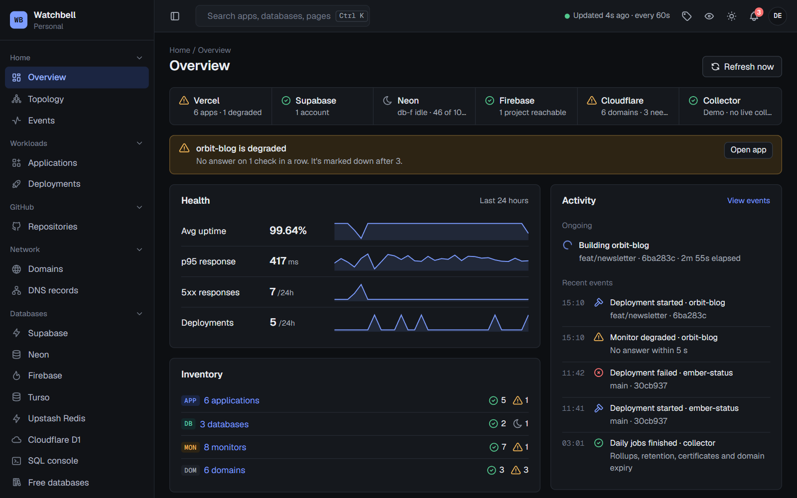
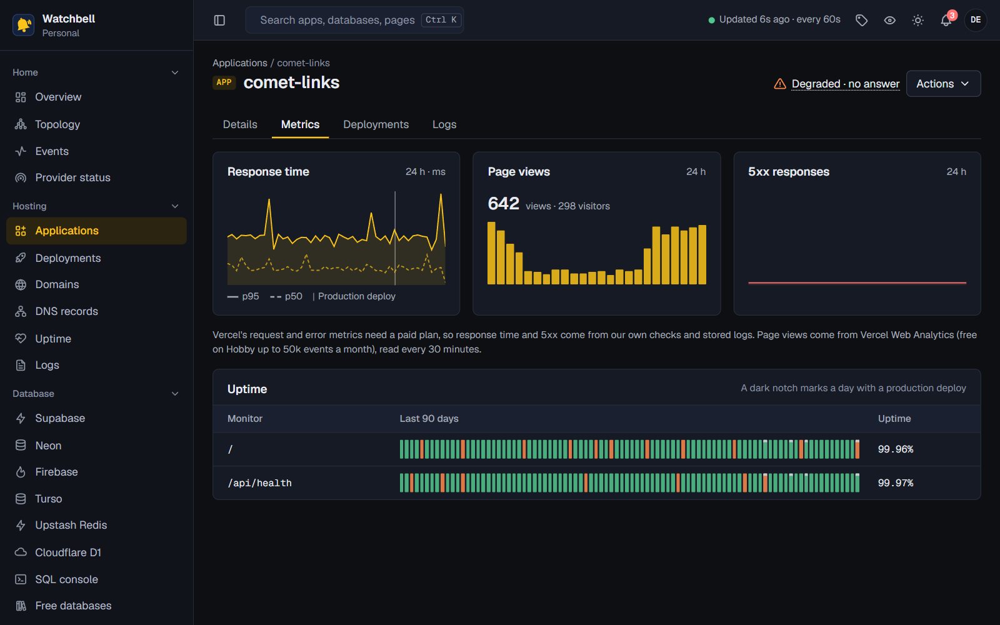
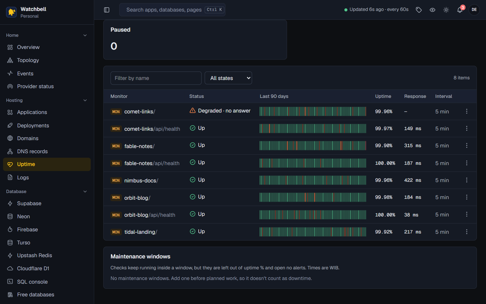
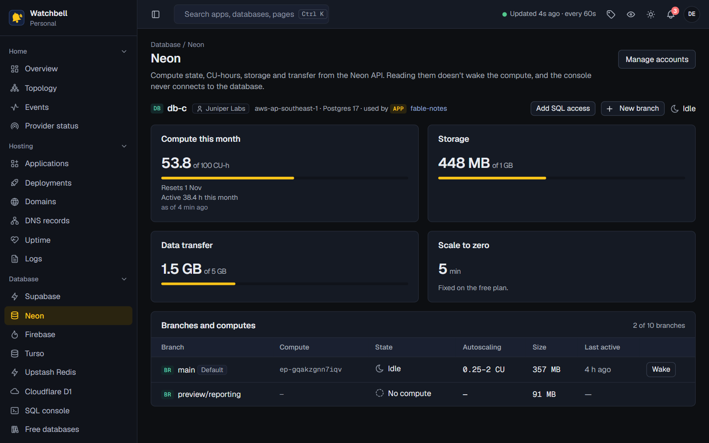
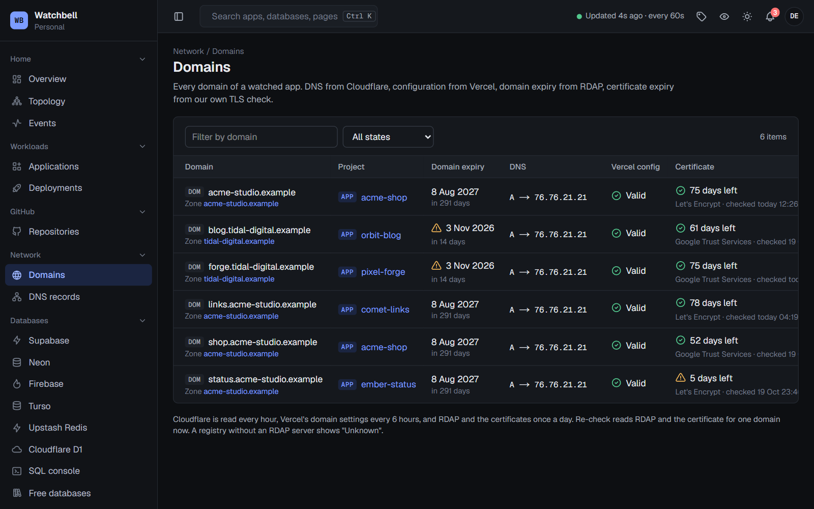
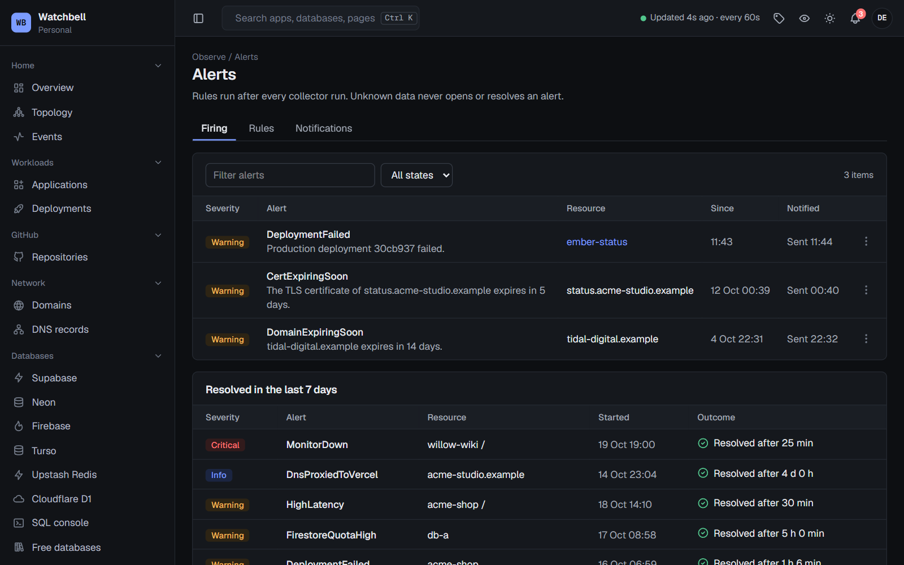
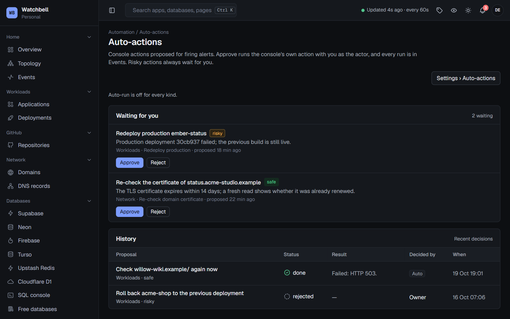
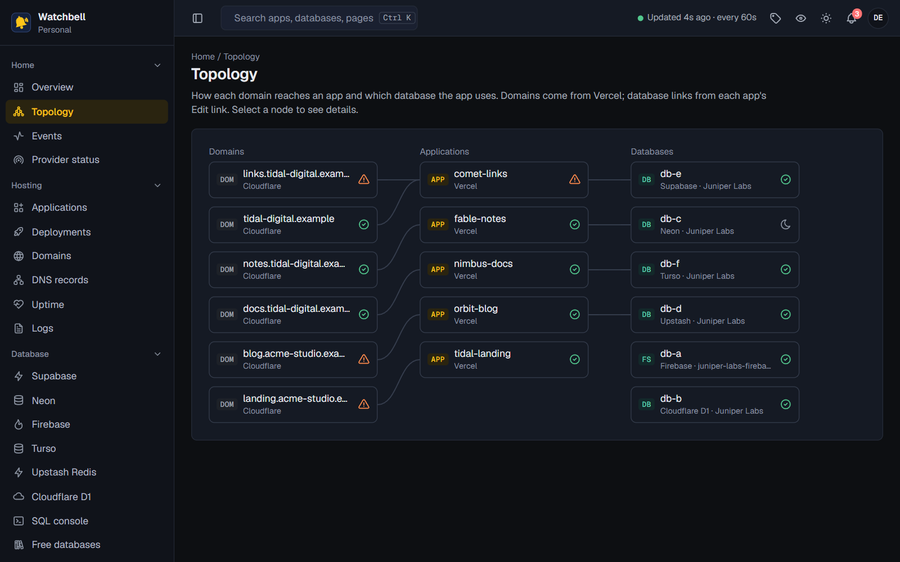
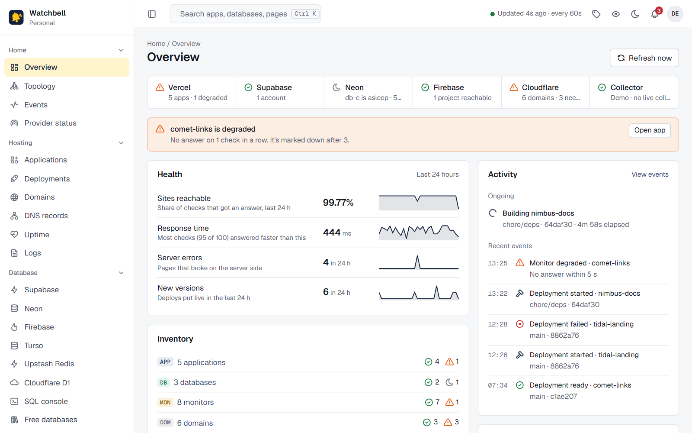
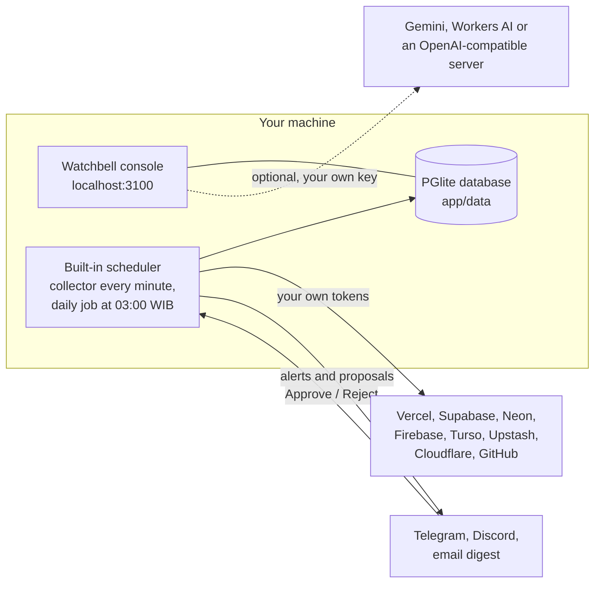

<h1 align="center">Watchbell</h1>

<p align="center">
  <strong>The self-hosted ops console for indie developers on free tiers.</strong><br>
  Your Vercel apps, databases and domains on one screen, on your own machine. It tells you when something breaks and
  fixes it only after you say yes.
</p>

<p align="center">
  <a href="LICENSE"></a>
  <a href="docs/install.md#what-you-need"></a>
  <a href="docs/install.md"></a>
  
  <a href="docs/faq.md#does-my-data-leave-my-machine"></a>
</p>

<p align="center">
  <a href="#quick-start">Install</a> ·
  <a href="docs/README.md">Docs</a> ·
  <a href="CHANGELOG.md">Changelog</a>
</p>

<picture>
  <source media="(prefers-color-scheme: dark)" srcset="docs/images/overview-dark.png">
  <source media="(prefers-color-scheme: light)" srcset="docs/images/overview-light.png">
  
</picture>

<p align="center"><sub>Every screenshot comes from Watchbell's demo mode. The apps, databases and domains in them are made up.</sub></p>

## Why Watchbell

Free plans are generous, but the dashboards are scattered: a Vercel tab, a Supabase tab, a Neon tab, Cloudflare,
GitHub, and a reminder that a free Supabase project pauses after a quiet week. Watchbell puts all of that on one
screen.

- **One console for many providers.** Vercel, Supabase, Neon, Firebase, Turso, Upstash Redis, Cloudflare (DNS and D1)
  and GitHub, read through their own APIs with tokens you paste once.
- **Built around free plans.** Meters compare usage with each free limit. It keeps a quiet Supabase project from
  being paused, and it reads Neon without waking the compute.
- **Runs on your machine, with no account.** A local database, a built-in scheduler and no cloud service of its own.
  Tokens are encrypted (AES-256-GCM) before they are stored and never reach the browser. No telemetry.
- **Acts only when you say yes.** When an alert fires, Watchbell can propose a fix: check again, wake a database, roll
  back a bad deploy. You approve it in the console or with a button on Telegram.
- **Free and open source.** MIT licensed. AI features use your own provider key and are optional.

## Features

<table>
  <tr>
    <td width="50%"></td>
    <td width="50%"></td>
  </tr>
  <tr>
    <td><b>Applications.</b> Response time, page views, 5xx responses, deployments and logs for each Vercel app.</td>
    <td><b>Uptime.</b> HTTP checks every minute, heartbeats for your own jobs, and 90 days of history.</td>
  </tr>
  <tr>
    <td></td>
    <td></td>
  </tr>
  <tr>
    <td><b>Databases.</b> Free-plan meters for Supabase, Neon, Firebase, Turso, Upstash Redis and Cloudflare D1.</td>
    <td><b>Domains.</b> Registration and certificate expiry, DNS from Cloudflare and configuration from Vercel.</td>
  </tr>
  <tr>
    <td></td>
    <td></td>
  </tr>
  <tr>
    <td><b>Alerts.</b> Built-in rules, sent to Telegram, Discord or a daily email.</td>
    <td><b>Auto-actions.</b> Proposed fixes that run after you approve them, here or on Telegram.</td>
  </tr>
  <tr>
    <td></td>
    <td></td>
  </tr>
  <tr>
    <td><b>Topology.</b> Which domain reaches which app, and which database each app uses.</td>
    <td><b>Light and dark.</b> Both themes, and a command palette (Ctrl+K) to jump to any page.</td>
  </tr>
</table>

### Workloads

- Vercel apps: status, deployments, request logs and stored errors (Vercel's free plan keeps only a short history, so
  Watchbell keeps warnings and errors for 7 days).
- Response time and 5xx responses from Watchbell's own checks, and page views from Vercel Web Analytics.
- Redeploy, roll back and check now, for operators and owners.
- A topology map of domains, apps and databases, and an events page that doubles as the audit log.
- GitHub: a read-only repository browser with Actions runs and dependency advisories.

### Uptime and heartbeats

- HTTP checks every minute, with 90-day bars and response times.
- Heartbeats for cron jobs and scripts: your job calls `/api/ping/<token>` (add `/start` or `/fail` to report those
  states), and Watchbell alerts when a ping is late.
- Maintenance windows, one-off or weekly, that open no alerts and don't count against uptime.
- An optional public status page with uptime badges for your READMEs.

### Databases

- **Supabase:** status, region, Postgres version and size. Keep active warns from day 5 without traffic and sends one
  keep-alive query a day so a free project isn't paused. Auto-restore brings a paused project back.
- **Neon:** compute state, CU-hours, storage and transfer, read without waking the compute. Wake it with one click.
- **Firebase (Firestore), Turso, Upstash Redis and Cloudflare D1:** usage against the free limits.
- Requests for a new project, database or DNS record are checked first and run only after an owner approves them.

### Domains, DNS and TLS

- DNS from Cloudflare, configuration from Vercel, registration expiry from RDAP and certificate expiry from
  Watchbell's own TLS check.
- A warning when a domain is proxied through Cloudflare in front of Vercel, with a one-click fix.
- Edit DNS records or add new ones (records are never deleted from Watchbell).

### Alerts and notifications

- Built-in rules: an app down or slow, a failed deployment, a paused or nearly full database, a domain or certificate
  about to expire, an expiring token, a vulnerable dependency, the collector not running, and more.
- Telegram, Discord and a daily email digest, each in English or Bahasa Indonesia.
- Status feeds from Vercel, Supabase, Neon, Cloudflare, Firebase and Google Cloud, so you can tell when an alert is
  caused by the provider and not your app.

### Auto-actions with Telegram approvals

- Each alert can propose a fix: check again, wake Neon, send a Supabase keep-alive, re-check a certificate, redeploy,
  roll back, restore a paused project, or open a pull request that updates a vulnerable package.
- **Safe** actions only read or nudge, and you can let each kind run on its own. **Risky** actions always wait for
  you, and on Telegram they ask twice.
- Optional auto-rollback, off by default, for a production deploy that breaks the app in its first minutes.
- The Telegram buttons work on a laptop with no public address, because Watchbell polls Telegram for button presses.
  No webhook or tunnel is needed.

### AI gateway with your own keys

- Bring your own key: Google Gemini, Cloudflare Workers AI, or any OpenAI-compatible server, including Ollama or
  LM Studio on your own machine.
- An OpenAI-compatible endpoint (`/api/v1/ai`) for your own apps, with scoped API keys, rate limits, usage and logs.
  Logs keep metadata only, never prompts or answers.
- An MCP server (`/api/v1/mcp`) that lets AI agents read your console.
- Watchbell has no AI of its own. Every AI feature is optional and stays off until you connect a provider.

### SQL console

- Read-only queries against your Supabase and Neon databases, and a query builder for Firestore.
- Every query runs as a read-only role you create for Watchbell, inside a read-only transaction that is then rolled
  back.

### Backups and access

- Optional monthly summaries saved to your own Google Drive. Backing up Watchbell means copying `app/data` and
  `app/.env` (with the npm package: the `~/.watchbell` folder, or your `WATCHBELL_HOME`).
- Owner, operator and viewer roles, an authenticator app (TOTP) for owners and operators, and a one-time setup code
  for the first sign-in.
- An API explorer for every `/api/v1` endpoint, built from one OpenAPI 3.1 file.

## Quick start

You need **Node 24**. The [install guide](docs/install.md) has the details.

### With npm (the fastest way)

```bash
npm install -g watchbell
watchbell
```

That's it: no clone and no build. The first start creates `~/.watchbell/` with your settings (fresh secrets) and the
database, prints a one-time setup code and opens http://localhost:3100/setup in your browser.

| Command | What it does |
|---|---|
| `watchbell` | Start Watchbell (`--no-open` skips the browser) |
| `watchbell stop` / `watchbell status` | Stop it cleanly / show whether it runs and where |
| `watchbell service install` | Start it when you log in (systemd user service or a per-user Scheduled Task, no admin) |
| `watchbell reset-login <email>` | Locked out? Set a temporary password (while Watchbell is stopped) |

Update with `npm install -g watchbell@latest`; your settings and data stay in `~/.watchbell/`.

### From the source, with the installers

**Linux** (tested on Ubuntu 22.04 and 24.04; the installer offers to install Node 24 for you):

```bash
git clone https://github.com/watchbell/watchbell.git
cd watchbell
bash install.sh
```

**Windows 10 and 11** (install Node 24 from https://nodejs.org/dist/latest-v24.x/ first): download or clone the
repository into a new, empty folder, then double-click `install.bat` or run it in a terminal:

```bat
install.bat
```

**macOS:** use npm above, or follow the [manual steps](docs/install.md#macos-and-manual-installs).

The installer checks the prerequisites, writes `app/.env` with fresh secrets, builds the app, offers to start
Watchbell automatically at login, and prints the address to open. To choose a different port, skip the auto-start or
answer yes to every question, see [Installer options](docs/install.md#installer-options). To run it by hand instead
of as a service, run `npm run start:selfhost` in `app/`; if you are ever locked out, stop Watchbell and run
`npm run reset-login -- <email>` in `app/`.

### First sign-in

1. Open **http://localhost:3100/setup** and enter the one-time setup code. It is printed when Watchbell starts and
   saved in `data/setup-code` (`~/.watchbell/data/` with npm, `app/data/` with the installers).
2. Create the owner account and set up your authenticator app.
3. On **Connections**, paste a Vercel token, press **Sync** and pick the apps to watch. Add your database providers.
   [Connect providers](docs/providers.md) lists the smallest permissions each token needs.
4. On **Alerts › Notifications**, connect Telegram, Discord or the email digest.

## How it works



- **Local database.** PGlite (Postgres compiled to WebAssembly) keeps everything in `app/data`. You don't need a
  database server.
- **Built-in scheduler.** A collector runs every minute (each task only when its own interval has passed), alert rules
  run after every collector run, and a daily job runs at 03:00 WIB. Nothing runs while the machine is asleep. A missed
  daily job runs once when Watchbell is back.
- **Your own provider tokens.** Watchbell reads each provider through its official API with a token you create. It
  encrypts tokens with your `OPS_ENCRYPTION_KEY` and uses them only to talk to that provider.
- **Nothing phones home.** Watchbell talks only to the providers, notification channels, AI provider and Google Drive
  you set up, plus public status pages and RDAP. There is no telemetry, and no account with the Watchbell project.

## Requirements

| | |
|---|---|
| Runtime | Node.js 24 (any 24.x) with npm |
| Disk | About 2 GB free for dependencies and the build, plus room for your data |
| Memory | 2 GB or more recommended (the build is the heaviest step) |
| Linux | Ubuntu 22.04 or 24.04 tested; other distributions with bash and systemd should work |
| Windows | Windows 10 or 11 with Windows PowerShell 5.1 |
| macOS | [Manual install](docs/install.md#macos-and-manual-installs) |

The installers never use `sudo` or administrator rights and never open a firewall port.

## Documentation

| Guide | What's in it |
|---|---|
| [Install](docs/install.md) | Linux and Windows installers, manual steps for macOS, upgrade and uninstall |
| [First run](docs/first-run.md) | Setup code, owner account, authenticator, more people, locked out |
| [Pages](docs/pages.md) | What every page in the console shows |
| [Connect providers](docs/providers.md) | Which token each provider needs, with the smallest permissions |
| [Notifications](docs/notifications.md) | Telegram (with approval buttons), Discord and the daily email digest |
| [Auto-actions](docs/auto-actions.md) | Proposed fixes, safe auto-run, auto-rollback, approvals on Telegram |
| [AI](docs/ai.md) | Your own AI keys, the gateway, API keys and the MCP server |
| [SQL console](docs/sql-console.md) | Read-only queries against Supabase, Neon and Firestore |
| [Backups](docs/backups.md) | Back up and restore Watchbell, monthly summaries in Google Drive |
| [Configuration](docs/configuration.md) | Every `app/.env` setting, LAN access, reverse proxy |
| [Troubleshooting](docs/troubleshooting.md) | Common errors and how to fix them |
| [FAQ](docs/faq.md) | Everything else |

An online copy of the documentation and a live demo with made-up data are coming soon.

## FAQ highlights

**Does it cost anything?** No. Watchbell is free and MIT licensed, and the providers it watches are your own accounts
on their free plans. AI features use your own key, and the email digest uses your own Resend account.

**What happens when my laptop sleeps?** Nothing is checked while Watchbell isn't running. When it is back, the
collector catches up and button presses made on Telegram in the meantime are handled. For round-the-clock checks, run
it on a machine that stays on. [More](docs/faq.md#what-happens-when-my-laptop-sleeps-or-is-off)

**Can I run it on a server?** Yes. The same installer works on a Linux server. Put a reverse proxy with HTTPS in front
if you want to reach it from elsewhere. [More](docs/faq.md#can-i-run-it-on-a-server-instead-of-a-laptop)

**Is there a Docker image?** Not in version 1.0. Use the installers or the
[manual steps](docs/install.md#macos-and-manual-installs).

**Why are times in WIB?** Schedules and message times use Western Indonesian Time (UTC+7), where Watchbell was first
written. The time zone isn't a setting yet. [More](docs/faq.md#why-are-times-shown-in-wib)

See the [FAQ](docs/faq.md) for the rest.

## Contributing

Bug reports, fixes, documentation and small features are welcome. [CONTRIBUTING.md](CONTRIBUTING.md) explains how to
set up a development copy, which checks to run and how to send a change. Developer notes are in
[app/README.md](app/README.md).

## Security

Please report vulnerabilities privately through GitHub's private vulnerability reporting, not in a public issue. See
[SECURITY.md](SECURITY.md).

## License

MIT © 2026 [Trias](https://github.com/Trias1). See [LICENSE](LICENSE).
